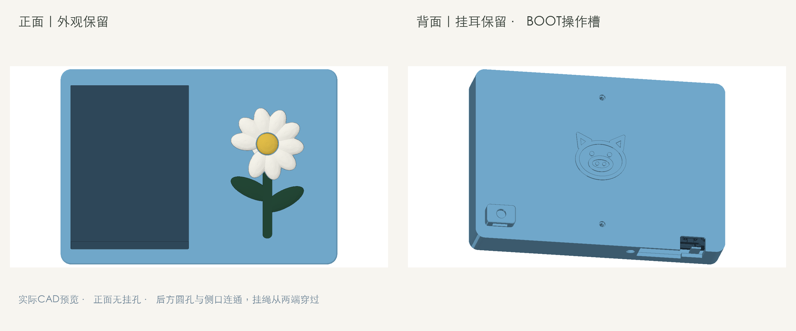

# 念念 · V10 打印文件

电子追星卡片挂件外壳：左侧屏幕、右侧立体雏菊，背面小猪与隐藏挂耳。

**正式装配共 8 个打印件，使用 01～06 六份排版文件。当前是分件装配版。**

[下载打印包 ZIP](https://github.com/Judy-Algorithm/NianNian/raw/refs/heads/main/downloads/NianNian_V10_printing.zip) · [正式打印文件](printing/v10/plates/) · [独立 STL](printing/v10/stl/) · [装配说明](docs/assembly.md)

## 先试装，再打印整壳

先打印 [08_USB 与按键试装片](printing/v10/fit-check/08_先打USB与按键试装.3mf)，用实际板卡和 USB 线检查插头、BOOT、RESET。

试装通过后，打印下方 01～06。试装件不计入成品的 8 个零件，**不必把所有试装文件重复打印**。

## 正式打印：01～06

| 排版文件 | 零件 | 建议颜色 |
|---|---|---|
| [01 前壳与电池盒](printing/v10/plates/01_前壳与电池盒_蓝色.3mf) | 前壳、电池盒 | 蓝色 |
| [02 后盖与压框](printing/v10/plates/02_背面挂耳后盖与压框_蓝色.3mf) | 后盖、主板压框 | 蓝色 |
| [03 电池盖](printing/v10/plates/03_电池盖_蓝色.3mf) | 电池盒盖 | 蓝色 |
| [04 花瓣](printing/v10/plates/04_立体花瓣_白色.3mf) | 整片花瓣 | 白色 |
| [05 花心](printing/v10/plates/05_立体花心_黄色.3mf) | 花心 | 黄色 |
| [06 枝叶](printing/v10/plates/06_花梗叶片_深绿或黑色.3mf) | 花梗与叶片（一体） | 深绿或黑色 |

挂耳与小猪已和后盖一体，不用另外打印；白色花瓣也不是一瓣一瓣拼装。

## 拓竹 X1 使用

- 导入 3MF 后，选择实际的 X1 机型、喷嘴、材料及支撑设置，再切片；单位为毫米，比例 100%。
- 这些是通用几何排版，**不是已经配置好机型、支撑、AMS 和耗材的打印工程，也不是 G-code**。
- 花瓣、花心和枝叶分别打印后粘装；当前包不是 AMS 自动多色一体版。
- [打印方向与装配步骤](docs/assembly.md)中有各件方向和螺丝说明。

已做网格及几何检查；尚未实物试打、整机试装及挂耳承重验证。实际电池整包、插头高度与线头尺寸需先试装确认。**V10 整套使用，不混用旧版零件。**
