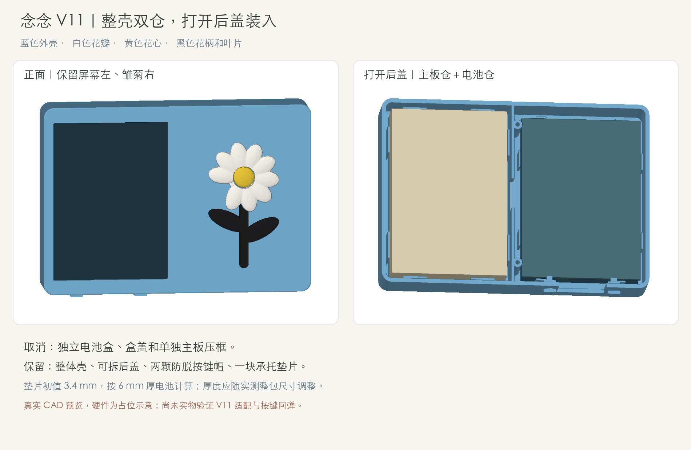

# 念念 · V11 整体双仓外壳

左侧屏幕与主板、右侧电池。一个整体壳体、一片可拆后盖、两颗防脱按键帽、一块电池垫片；保留右侧立体雏菊和背面小猪、挂耳。

**配色：壳体蓝色、花瓣白色、花心黄色、花柄及叶片黑色。**

[下载 V11 打印包](https://github.com/Judy-Algorithm/NianNian/raw/refs/heads/main/downloads/NianNian_V11_printing.zip) · [先试装：00 完整屏框与按键帽](printing/v11/fit-check/00_整板定位与按键帽试装.3mf) · [正式排版](printing/v11/plates/) · [装配说明](printing/v11/README.md)

先打 00，用实际主板、线头和按钮检查后，再打印 01～03 整壳。**V11 尚未实物验证；不要与 V10 的壳、后盖混装。**

- 成品共 8 件：壳、后盖、两个帽子、垫片、白色花瓣、黄色花心、黑色枝叶。
- 电池垫片名义厚 3.4 mm，按整包 6 mm 厚电池计算；实测后应调整，不能压紧电芯合盖。
- 3MF 是通用几何排版，仍需在 Bambu Studio 选择实际机器、材料和支撑设置。
- 本版不包含独立断电开关；两个帽子操作原板 BOOT、RST。

[参数化 CAD 与 STEP 下载](https://github.com/Judy-Algorithm/NianNian/raw/refs/heads/main/downloads/NianNian_V11_CAD.zip)

## 旧版存档

[V10 文件](printing/v10/)仍保留用于追溯。旧 08 局部试片已经打印，但未确认孔位适配；V11 用完整定位试件替代。不要继续使用 V10 的 01～03 打印当前设计。
