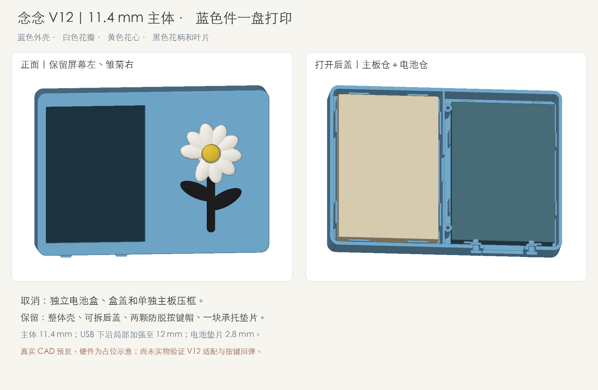

# 念念 · V12 完整打印版

主体 **79×55.8×11.4 mm**；USB 下沿局部加强至 12 mm。保留屏幕左、雏菊右、背面小猪和隐藏挂耳。

## 直接打开这一份

[下载一盘五件 PETG 打印工程](https://raw.githubusercontent.com/Judy-Algorithm/NianNian/main/printing/v12/project/打开这个_V12_蓝色全套5件_PETG.3mf)

已预设：**X1 Carbon、0.4 mm 喷嘴、纹理 PEI 板、Generic PETG、0.20 mm 层高**；后盖自动支撑，两颗帽子带 3 mm 外圈附着边。经 Bambu Studio 2.9.1.70 实际切片并重新导入验证，预计约 **55 分钟、21 g**。实际打印前仍需核对现场机型、喷嘴、材料和料槽。

一盘包含前壳、后盖、2.8 mm 电池垫片、BOOT 帽、RESET 帽。白花瓣、黄花心、黑花柄沿用已打印的花件，成品共 8 件。不是将所有部件融合打印；完成后仍需装配和粘装花件。

[完整打印包](https://raw.githubusercontent.com/Judy-Algorithm/NianNian/main/downloads/NianNian_V12_printing.zip) · [完整 CAD／装配 STEP／参数化源文件](https://raw.githubusercontent.com/Judy-Algorithm/NianNian/main/downloads/NianNian_V12_CAD.zip) · [装配说明](printing/v12/README.md) · [独立 STL](printing/v12/stl/)

## 本次修订

- 主体由 12 mm 减为 11.4 mm，垫片由 3.4 mm 改为 2.8 mm。
- 后方 U 槽装入按键帽，后盖舌片限位；USB 与两个按钮采用原厂中心坐标。
- USB 开口保持已能插线的 14×7 mm，真实包胶宽厚尚未测量，不按斜拍卷尺直接缩孔。
- 为避免薄壳的 USB 下沿只剩 0.25 mm，增加局部 0.6 mm 加强。花件和挂耳另外凸出，整机最大厚度并非 11.4 mm。

**几何与网格检查通过，尚未实物试装 V12。** 实际按键回弹、PETG 收缩、电池及导线空间、承重仍需现场确认。壳、后盖和本版垫片成套使用，不混装旧版壳盖或旧 3.4 mm 垫片。

若 Bambu Studio 版本过旧提示不兼容，优先更新软件；[备用纯模型](printing/v12/geometry-backup/)不含 PETG 与支撑预设，需重新设置后切片。

旧版仅作存档：[V11.1](printing/v11_1/) · [V11](printing/v11/) · [V10](printing/v10/)。
