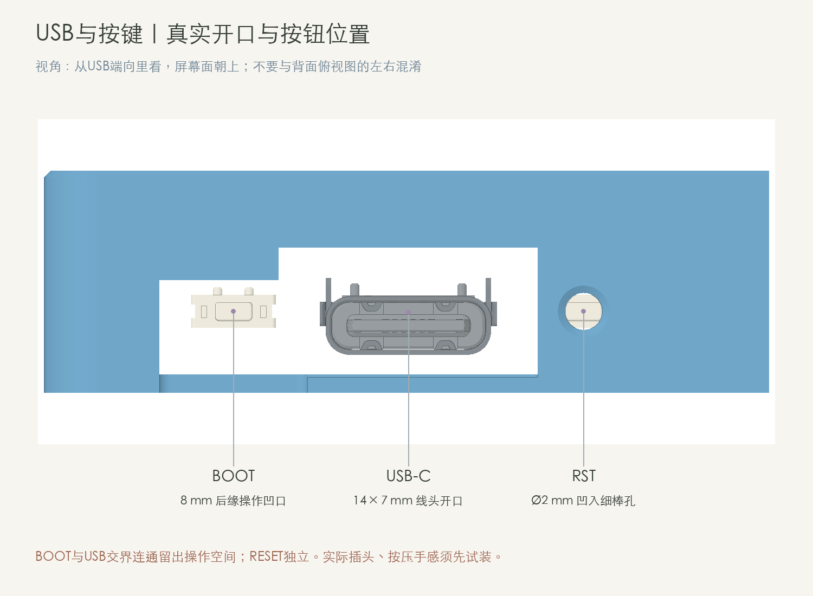
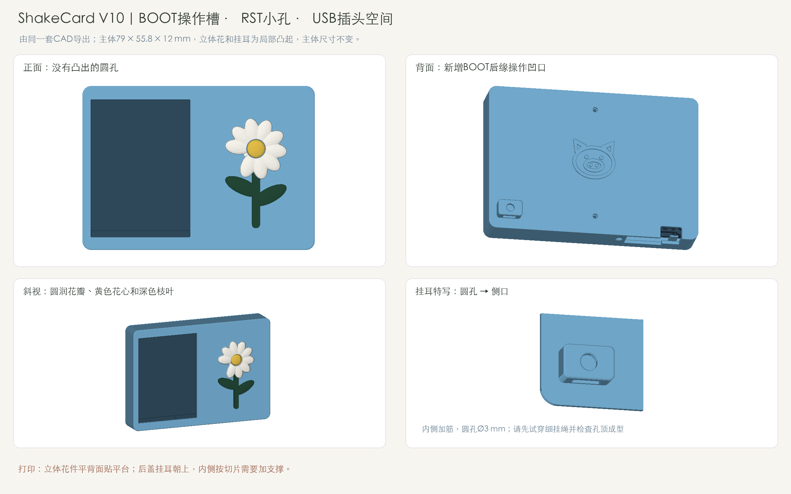

# V10 打印与装配

确定配色：外壳蓝色、花瓣白色、花心黄色、花梗与叶片黑色。实际耗材需与发送打印时选择的料槽一致。

## 一共 8 个打印件

| 文件 | 零件 |
|---|---|
| `A_main.stl` | 前壳 |
| `A2_board_retainer.stl` | 主板压框 |
| `B_battery_box.stl` | 电池盒 |
| `B2_battery_lid.stl` | 电池盒盖 |
| `C_pig_rear_hidden_loop.stl` | 后盖，挂耳与小猪已一体打印 |
| `D_daisy_petals.stl` | 一整片白色花瓣 |
| `D2_daisy_center.stl` | 黄色花心 |
| `D3_stem_leaves.stl` | 黑色一体花梗与叶片 |

[独立 STL](../printing/v10/stl/) · [6 份正式排版文件](../printing/v10/plates/)

另备：电池盒盖用 M1.6 × 4 螺丝 2 颗，后盖用 M1.6 × 5 螺丝 2 颗，以及少量胶。长度是试装起点，先核对有效牙长和实际孔深。

## 先打 USB/按键试片

使用 [08_先打USB与按键试装.3mf](../printing/v10/fit-check/08_先打USB与按键试装.3mf)，包含前壳与后盖的两个局部试片。

当前 08 试片已打印，孔位适配尚未确认，暂不打印完整外壳。两个试片应在同一 USB 边沿屏幕正反方向合拢，不能分别摆在板卡左右两侧判断适配；仍需实物检查是否有偏差。

1. 暂不接锂电池，手扶板卡对齐试片的定位边与屏幕边框，再贴合后盖试片。试片不能独立夹住整块板。
2. 插入实际 USB 线，应能插到底，包胶不能顶壳或压住按钮。
3. 从 BOOT 后缘凹口试按，可用指甲；原板小键内缩，不能把凹口当作普通大按键。
4. 用约 1 mm 钝头绝缘细棒沿 RESET 小孔轻按。BOOT 的日常行为由固件决定，本包没有更改固件。

USB 开口为 **14 × 7 mm**；只验证过 **12 × 6 mm** 参考包胶轮廓，不能保证所有线头适配。BOOT 操作凹口宽 **8 mm**，RESET 小孔 **Ø2 mm**。

图中视角是“从 USB 端向里看、屏幕面朝上”；不要直接套用背面俯视图的左右，实物以 PCB 丝印复核。

[可选试装文件](../printing/v10/fit-check/)还包含屏框、电池包络与挂耳试片。`00` 已含三个试片，`07` 是其中挂耳片的单独排版，`08` 是 USB/按键试片，不需要全部重复打印。

## 打印方向

选择实际拓竹机型、喷嘴和材料。0.4 mm 喷嘴、0.2 mm 层高可作为试打起点，先检查逐层路径。

| 零件 | 摆放 |
|---|---|
| 前壳、电池盒 | 开口朝上 |
| 主板压框 | 平面贴平台，脚朝上 |
| 电池盒盖 | 平面贴平台 |
| 花瓣、花心、枝叶 | 平整背面贴平台，圆润面朝上 |
| 完整后盖 | 小猪和挂耳朝上；内侧悬空区域需按切片结果加支撑 |
| USB 后盖试片 | 平整外表面可贴平台；与完整后盖方向不同 |

挂耳通道内如生成支撑，确认能从两端清除。试片打印通过，不等于整机承重验证。

## 装配顺序

1. 清理支撑和孔位，先进行不通电试装。打印、打磨、上胶和钻孔时，取出电子件与电池。
2. 将白色花瓣、黄色花心和枝叶对照预览定位，用少量胶粘到前壳平面；等胶完全固化。
3. 屏幕朝向左侧开窗，USB 对准底边；放入板卡，压框对准主板支承点。必要时在承托点用薄绝缘软垫消隙，不挤压显示面或元件。
4. 将电池放入独立电池盒，装盒盖，用两颗 M1.6 × 4 螺丝固定；确认线没有夹在接缝里。
5. 电池盒放入右侧，连接电池前核对插头正负极。插头高度、线长和绕行空间都需实物确认，不能硬压电芯关盖。
6. 合上后盖，用两颗 M1.6 × 5 螺丝固定，再检查 USB 插拔、BOOT、RESET 与 TF 卡维护空间。

## 尺寸与验证范围

- 主体：**79 × 55.8 × 12 mm**。
- 花件局部凸出约 2.1 mm，背挂耳局部凸出 3.8 mm；最大厚处约 17.9 mm，另计螺钉头。
- 电池按整包 **50 × 34 × 6 mm** 设计，电池盒净腔 **50.8 × 34.8 × 6.8 mm**，底部另计 0.3 mm 绝缘垫。503450 型号不能代替含保护板、胶带与出线端的整包测量。
- 背面 **Ø3 mm 圆孔**与 **4.8 × 2 mm 侧口**连通，适合先试细手机挂绳；尚未做承重与耐磨测试。
- 网格和几何检查见 [validation](../validation/)。08 试片已实际打印，但未确认适配；未完成整机试装、跌落和温升测试。

本仓库只收录打印文件和装配资料，不包含 App、固件或已配置完成的 AMS 多色一体打印工程。
